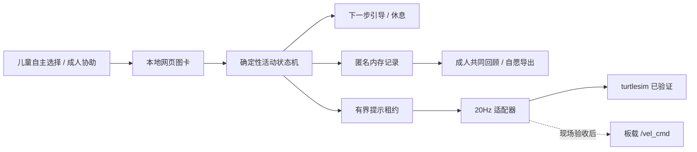

# 慢慢星：把“陪伴”做成可选择、可预测、可停止的互动

## 1. 产品定位与范围

主题：基于 CBT 原则的游戏化陪伴机器人，面向孤独症儿童社交沟通与情绪调节的辅助交互。机器人是孩子与成人之间的共同活动媒介，成人负责理解情境、提供支持和迁移到生活；产品不承担诊断、治疗或独立照护职责。

第一版共同设计的目标人群假设是约 6–10 岁、能在熟悉成人协助下进行图卡选择的儿童。年龄不代表能力或适配结论，需要按语言理解、感官偏好、运动需求与个人意愿调整。对尚不能理解替代性想法的孩子，仅使用情绪表达和共同活动，不强行开展认知重构。真实儿童使用前，应邀请熟悉孤独症支持的专业人员审阅内容，并由监护人同意、孩子按可理解方式表示愿意。

## 2. 场景与价值假设

家庭或支持空间内，孩子和熟悉成人一起完成 3–5 分钟的可预测小游戏。主要问题假设：纯口语提示负担较高、表达需要的方式较少、情绪升高时继续要求完成任务可能增加负担、小游戏难以迁移到生活。这些是产品假设，并非通过用户研究得出的普遍事实。

机器狗的潜在价值是作为可预测的互动伙伴，让轮流、等待、求助成为共同注意的对象。它的声音、动作、外观也可能带来感官压力，因此本版允许完全不接机器狗，先用静态图卡完成全部核心活动。没有机器人动作也能成功参与。

## 3. CBT 原则到交互的映射

| 原则 | 活动 | 输入与提示 | 观察内容 | 边界 |
| --- | --- | --- | --- | --- |
| 识别感受与需要 | 心情气象站 | 自选天气卡 → 选择需要 → 可选表达 | 孩子选择了什么支持 | 不从表情推断情绪；不追问必须解释 |
| 身体觉察与可选应对 | 云朵充电站 | 自愿自然慢呼吸/只看云朵/休息 → 自述感受 | 哪种方式更舒适 | 不屏气、不要求达到频率，不适立即停 |
| 渐进的行为练习 | 轮流小星球 | 选择谁先 → 送星星/请求帮助 → 练一句轮流表达 | 参与和沟通方式 | 不把服从、眼神接触作为目标 |
| 情境—想法—感受—行动 | 勇气小桥 | 同伴未回应情境 → 感受 → 多种可能 → 自选请求 | 是否愿意尝试其他解释与表达 | 不否定孩子原有感受，不声称知道同伴意图 |

MVP 简化为固定三步活动；“勇气小桥”的情境先在提示中给出，感受由孩子选，随后给替代性解释与可选行动。成人在结束后补充真实事件讨论，避免把四张卡当成完整 CBT 治疗。

## 4. 交互规则

成人在场确认 → 选择活动 → 三步图卡/手势/成人协助 → 完成或休息 → 成人共同回顾。默认无音频、无动态效果。减少动态可选关闭后，云朵以 8 秒周期缩放作为可选视觉节奏；不要求孩子跟随。用户系统的“减少动态”设置也会被尊重。

每张活动卡可跳过，没有计时惩罚、正确答案、负面反馈、连续签到或排行榜。记录“完成活动数”仅用于回顾，即使全部跳过也可完成，不作为能力或服从评价。UI 不展示分数。成人设置不提供突然发声或真机运动按钮。

“我想休息”是本次活动的停止请求，不等同于硬件急停。休息锁定后服务不再签发动作，恢复要求成人确认，回到活动选择，不恢复旧动作。实际设备动作受到本地桥接器短租约约束；其停止只是多层保护的一部分。

## 5. Agent 结构

大模型不参与运动决策。本版没有依赖聊天 API 的环节，避免幻觉、内容不可控和网络中断阻断互动。将来若增加语言生成，应限定为成人可审核的表达改写或故事，不把原始对话直接执行为动作。

## 6. 数据与失败路径

服务仅监听回环地址，前后端同源；拒绝跨来源 JSON 写请求。没有用户注册，无姓名、音视频或身份字段。记录仅包括活动、步骤、所选卡片与相对时间。服务运行期间暂存在内存，最多 100 会话，重启清除；成人可删除或导出。导出后文件属于本地保管范围，程序无法撤回已导出的副本。

| 失败情形 | 实现的行为 | 成人下一步 |
| --- | --- | --- |
| 孩子不愿回答 | 可跳过或休息，无惩罚 | 尊重选择，不要求继续 |
| 选择不舒服 | 转休息状态，取消动作租约 | 停止活动，观察并提供支持 |
| 页面重复点击/旧步骤提交 | 服务拒绝旧 revision，避免重复计数 | 按当前页面重试 |
| 网页刷新 | 当前进程中的 session 可恢复，休息锁定保留 | 确认孩子愿意再继续 |
| 服务关闭/会话删除 | 无法恢复旧会话；桥接租约到期后归零 | 真机异常优先使用物理急停 |
| 网络请求阻塞 | HTTP 超时 100ms，动作租约最多 150ms；ROS 线程独立 | 不以软件保证替代现场监护 |

## 7. 黑客松验收标准与已完成范围

功能验收：四活动可运行；没有确认不能创建会话；跳过可完成；不适/休息可终止；成人显式恢复；匿名记录可导出/删除。已有浏览器自动验证和 11 项单元测试。

仿真验收：真实 turtlesim 收到非零 Twist、姿态发生变化、提示到期归零、活动中暂停归零、服务中断归零。隔离 Domain 63 通过；具体消息数与延迟为单次本机测量，不是时延上限承诺。

真机验收尚未完成：设备型号/应用版本/开放权限、板载 ROS 桥接可用、实际提示是否温和、声音/灯光适配、硬件停止链路均需现场核对。首次真机联调只允许成人在隔离场地进行，不以儿童作为联调对象。

## 8. 后续验证，不提前宣称疗效

先由孤独症支持专业人员与照护者审查活动，再开展成人模拟，迭代明确提示、可理解的退出方式和感官负担。后续在正式同意与适当研究审查下开展小规模共同设计；重点观察自愿参与、主观舒适、主动请求、跳过是否可理解、成人提示量以及退出后的体验。录音录像另行取得许可，默认不记录。

不把重复行为减少、眼神接触增加或任务服从作为“改善”证据。若开展疗效评估，需要单独设计研究、明确适用对象、专业量表与对照方法，不能从游戏完成率推断。

## 9. 资料依据

- 《2026 选手参与手册》：10月22日提交环境与 Agent 基础成果，10月23日现场部署；不要求提前完成真机。不设置传统 PPT 路演，但用户提供的新表格第10项要求海报，故制作海报。
- CBT 原则依据：[NHS CBT 概述](https://www.nhs.uk/mental-health/talking-therapies-medicine-treatments/talking-therapies-and-counselling/cognitive-behavioural-therapy-cbt/)。为设计参考，不作为本产品有效性证据；本次未独立开展临床文献系统综述。
- 孤独症儿童支持应个体化，专业框架可参考 [NICE CG170](https://www.nice.org.uk/guidance/cg170)。此处提供阅读入口，未声称本原型已满足指南或得到机构认可。
